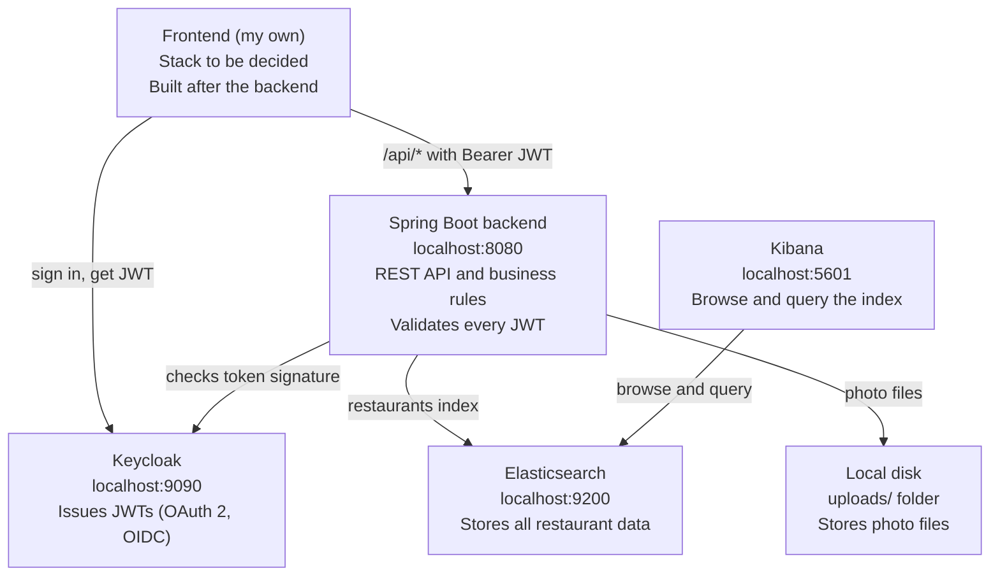

# Restaurant Review Platform - Project Brief

Last updated: 2026-11-10

**Type:** Portfolio project, backend first, deployed as a live demo

**Based on:** the Devtiro Restaurant Review App build guide (March 2025)

**Stack:** Spring Boot 4.1.2, Java 25, Elasticsearch 9.4.8, Keycloak 23; frontend stack to be decided

This project builds a restaurant review platform by following a tutorial, extends it with features of my own, and deploys it online as a live demo for my CV. This brief is the shared context: why the project exists, what the system does, how the parts fit together and how the work is planned.

Read this document first, then `API-CONTRACT.md`. Where the tutorial and the code disagree, the API contract records what the code actually does.

## 1. Background and motivation

People choose where to eat based on what other diners say. A review platform needs three things to be useful: restaurants are easy to find, reviews are trustworthy, and adding a review takes a minute.

The engineering interest of this project is **search**. Restaurant data is stored in Elasticsearch, not a relational database, so the backend can offer:

- **Fuzzy text search** on restaurant name and cuisine type, so a small typo in the search still finds the restaurant.
- **Geospatial search**, finding restaurants within a radius of a point.
- **Rating filters**, such as "4 stars and above".

The second goal is practice: building a layered Spring Boot backend the way it is done on real work, with DTOs and mappers at the API boundary, constructor injection, centralised error handling and JWT security through Keycloak.

**The end goal is a live demo.** The finished app will be deployed online, so it can be shown in interviews and linked from my CV. Until then it runs locally with fictional test data.

## 2. The product

The **Restaurant Review Platform** lets anyone, without signing in:

1. **Browse and search restaurants** by text, minimum rating or location, with pagination.
2. **View a restaurant's details**: photos, address, map location, opening hours, average rating and reviews.
3. **Read reviews**, sorted by date or rating.
4. **View photos** of restaurants and reviews.

and lets a signed-in user:

5. **Add a restaurant**, with address, opening hours and at least one photo.
6. **Update or delete a restaurant.**
7. **Write one review per restaurant**, with a 1 to 5 star rating, text and optional photos.
8. **Edit their own review within 48 hours** of posting it.
9. **Delete a review.**
10. **Upload photos** to attach to restaurants and reviews.

The restaurant's average rating is recalculated every time a review is created, updated or deleted.

## 3. Architecture

**I build the Spring Boot backend first and my own frontend later; the supporting services run in Docker.** The frontend talks only to the backend, and the backend is the only thing that writes to Elasticsearch.



The diner signs in through Keycloak and gets a JWT. The frontend sends it with every `/api/*` call, and the backend checks its signature against Keycloak before allowing any write.

| Component | Role | Runs as |
| --- | --- | --- |
| Frontend (my own) | User interface; built after the backend | To be decided |
| Backend (Spring Boot) | REST API, business rules, authorisation | `./mvnw spring-boot:run` |
| Elasticsearch | Primary data store and search engine | Docker |
| Keycloak | Sign-in, user management, token issuing | Docker |
| Kibana | Inspect and query stored data | Docker |
| Local disk | Photo files in `uploads/` | Backend file system |

**Trade-off:** using Elasticsearch as the main database gives fuzzy and geospatial search for free, but there are no transactions or joins. Reviews live inside the restaurant document, so two people reviewing the same restaurant at the same moment could overwrite each other.

## 4. Users and personas

These personas are illustrative, written to guide design decisions. They are not from the tutorial.

### Dana, diner (primary user)

- Looks for somewhere to eat, often on a phone, often near where she already is.
- Browses without an account. Signing in should only be needed to write something.
- Trusts reviews with photos more than text alone.
- Wants to sort reviews by newest or by rating.
- Success for Dana: "I found a good place nearby in under a minute, and I could leave my own review afterwards."

### Jacqui, restaurant owner

- Adds her restaurant with address, opening hours, contact details and photos.
- Updates details when opening hours or contact information change.
- Success for Jacqui: "My restaurant shows up when people search for my cuisine or my area."

In the current backend both personas are the same kind of account. There are no roles and no owner checks, see section 10.

## 5. Domain model

**Restaurant is the only top-level document** in Elasticsearch, stored in the `restaurants` index. Everything else is nested inside it. This makes search fast and simple, at the cost of manual pagination for reviews.

```text
Restaurant (index: restaurants)
├── name, cuisineType, contactInformation, averageRating
├── geoLocation (GeoPoint: lat, lon)
├── address (Address)
├── operatingHours (OperatingHours)
│   └── monday ... sunday (TimeRange: openTime, closeTime)
├── photos[] (Photo: url, uploadDate)
├── reviews[] (Review)
│   ├── content, rating, datePosted, lastEdited
│   ├── photos[] (Photo)
│   └── writtenBy (User)
└── createdBy (User)
```

| Object | Purpose | Key rules |
| --- | --- | --- |
| `Restaurant` | The central record | `averageRating` starts at 0 and is calculated from reviews, never set by the client |
| `Address` | Postal address | Street number must match `^[0-9]{1,5}[a-zA-Z]?$`; unit is optional |
| `OperatingHours` | One `TimeRange` per day | Any day may be omitted (closed) |
| `TimeRange` | Open and close time | 24-hour `HH:mm` strings, for example `"09:00"` |
| `Photo` | A stored image file | `url` holds the stored filename, for example `"<uuid>.png"` |
| `Review` | One diner's experience | Rating 1 to 5; one review per user per restaurant; editable for 48 hours |
| `User` | Who wrote or created something | Copied from the Keycloak JWT; not kept in sync if the user later changes their name |

In the tutorial code `createdBy` is never filled in when a restaurant is created, so it is always `null`.

## 6. Provided materials

| Item | What it is | How I use it |
| --- | --- | --- |
| `restaurant-backend/` | My Spring Boot backend, built by following the tutorial | The main deliverable |
| `docker-compose.yaml` | Elasticsearch, Kibana and Keycloak | Start the supporting services |
| `src/test/resources/testdata/` | 10 sample restaurant photos | Loaded by `RestaurantDataLoaderTest` |
| `PROJECT-BRIEF.md` | This document | Context, scope and plan |
| `API-CONTRACT.md` | The endpoint reference, checked against the code | Single source of truth for the API |

The frontend is not part of the tutorial build here. I will write my own after the backend is complete (section 9).

**Test account in Keycloak:** username `testuser`, password `password`, in the `restaurant-review` realm. For local development only.

## 7. Running locally

**Requirements:** JDK 25 and Docker. This project uses **Spring Boot 4.1.2 and Java 25**, newer than the tutorial's Spring Boot 3.4.2 and Java 21, so some tutorial code and configuration will need adapting. Each adaptation is noted in the README.

```bash
# Run from restaurant-backend/

# 1. Start Elasticsearch, Kibana and Keycloak
docker compose up -d

# 2. Run the backend (port 8080)
./mvnw spring-boot:run
```

| Service | URL | Notes |
| --- | --- | --- |
| Backend | http://localhost:8080 | Spring Boot default port |
| Keycloak | http://localhost:9090 | Admin console login `admin` / `admin` |
| Elasticsearch | http://localhost:9200 | Security disabled |
| Kibana | http://localhost:5601 | Dev console for raw queries |

**One-time Keycloak setup:**

1. Create the realm `restaurant-review`. It must match the backend's issuer URI.
2. Create the client `restaurant-review-app`, used to get tokens now and by my frontend later.
3. Create the test user from section 6, with "Temporary" password switched off.

**Sample data:** run `RestaurantDataLoaderTest` once to create 10 restaurants with photos.

## 8. Ways of working

- **Type it, don't paste it.** Write the code by following the guide, and only look at the tutorial's finished code when stuck.
- **One branch per feature.** For example `feature/photo-upload` or `feature/review-update`. Merge to `main` only when it works end to end.
- **Small commits, one per lesson or step.** The commit history should read like the build plan.
- **Test every endpoint as soon as it exists**, with an HTTP client (Postman, Bruno or curl).
- **Check data in Kibana.** Use the dev console to confirm what was actually stored in the `restaurants` index.
- **The contract comes first.** Any change to an endpoint's path, shape or status code is written in the `API-CONTRACT.md` change log before or with the code change.
- **Note what differs from the tutorial.** Every deliberate deviation gets one line in the README.

## 9. Plan and milestones

The plan follows the guide's own order. Each milestone ends in something that can be shown working; if it cannot be demonstrated, it is not done.

1. **Setup.** Spring Initializr project, Docker services, MapStruct with Lombok.
   - Done when: the app starts and connects to Elasticsearch; Kibana and Keycloak open in the browser.
2. **Domain and security.** All entities, `RestaurantRepository`, Keycloak realm and user, `SecurityConfig`.
   - Done when: a request without a token gets `401`, and the same request with a token gets past security.
3. **Photos.** Storage service, upload and download endpoints, global error handling.
   - Done when: a photo uploads and then displays in the browser at `/api/photos/{id}`.
4. **Restaurants.** Create, search, get, update, delete; load the sample data.
   - Done when: `GET /restaurants` returns the 10 sample restaurants and search filters them.
5. **Reviews.** Create, list, get, update, delete; average rating recalculation.
   - Done when: a posted review appears in the restaurant's review list and changes its `averageRating`.
6. **Backend complete.** Every endpoint in `API-CONTRACT.md` works end to end from an HTTP client, and the ownership gaps in section 10 are fixed.
7. **My own frontend.** Build the user interface against `API-CONTRACT.md`, with Keycloak sign-in.
   - Done when: a diner can search, view a restaurant, sign in and post a review entirely in the browser.
8. **Deploy the live demo.** Host the backend, frontend, Elasticsearch and Keycloak online, with HTTPS, no default passwords, Elasticsearch security switched on, and Keycloak and the frontend pointed at the public URLs. Load the sample data and create a demo account.
   - Done when: anyone with the link can browse restaurants, sign in with the demo account and post a review.
9. **Extensions.** New features of my own, one at a time, each with its own branch and contract change log entry, deployed to the demo as they land (section 10).

**Open question:** target dates for each milestone are not set yet, and the hosting provider is not chosen yet.

## 10. Known gaps and extension ideas

**Known gaps in the tutorial build.** These are found by reading the code, not by running it. Each is a good candidate for a first extension, and the ownership gaps should be fixed before the app goes public.

| Gap | Effect | Possible fix |
| --- | --- | --- |
| No ownership checks on restaurants | Any signed-in user can update or delete any restaurant | Set `createdBy` on create; allow update and delete only for the creator |
| No ownership check on review delete | Any signed-in user can delete any review | Check `writtenBy` before deleting, as update already does |
| `createdBy` is never set | Restaurant creator is always `null` | Pass the JWT user into `createRestaurant` |
| Location ignored when text is given | `q` plus `latitude`/`longitude`/`radius` searches by text only | Combine text, rating and `geo_distance` in one query |
| Random geolocation | Every address gets a random point in London | Call a real geocoding service such as OpenStreetMap Nominatim |
| Photo checks | File type and size are not validated; `loadAsResource` uses `exists() \|\| isReadable()` | Allow only images, set a size limit, use `&&` |
| `photoIds` sent as `null` | Likely a `500` instead of a `400` (not tested) | Add `@NotNull` beside `@Size(min = 1)` |
| Few automated tests | Only a manual data loader test | Unit tests for services, integration tests for controllers |

**Extension ideas.** None of these is decided yet.

- **Roles:** an `OWNER` role from Keycloak, so only owners create restaurants and only admins delete them.
- **Owner replies** to reviews.
- **Cuisine type filter**, which the API overview lists but the code does not implement.
- **Favourites:** a user's saved restaurants.
- **"Open now" filter** using operating hours.
- **Photo captions**, which the domain overview mentions but `Photo` does not store.
- **Moderation:** report a review, hide it pending review.
- **API documentation** with springdoc-openapi, so `/swagger-ui` shows every endpoint.

## 11. Licence and attribution

The Devtiro repository is licensed in two parts, and this project respects both.

| Part | Licence | What it requires |
| --- | --- | --- |
| Code (`backend/`, `frontend/`) | MIT | Keep the copyright line "Copyright (c) 2025 Devtiro Ltd" and the licence text with any copy or substantial part of the code |
| Guide (`docs/`) | [CC BY-NC-SA 4.0](https://creativecommons.org/licenses/by-nc-sa/4.0/) | Credit Devtiro, no commercial use, and share adaptations under the same licence |

Because my code closely follows the tutorial, the repository keeps Devtiro's MIT notice. The README states clearly what came from the tutorial and what I added. This brief and the API contract adapt material from the guide, so they are shared under CC BY-NC-SA 4.0 with credit to Devtiro Ltd.

## 12. Non-goals

- **No production-scale infrastructure.** The target is one small hosted demo, not high availability, autoscaling or real traffic.
- **No real user data.** All restaurants, reviews and accounts are fictional test data and demo accounts.
- **Only basic security hardening.** For the public demo: HTTPS, no default credentials, Elasticsearch security on, secrets kept out of the repository. No penetration testing or rate limiting.
- **No frontend until the backend is complete.** The backend is built and tested on its own first, with an HTTP client.
- **No mobile apps.** Web only.
- **No cloud file storage** in the base build. Photos are stored on disk in `uploads/`, so the demo host needs persistent disk storage.

## 13. Glossary

| Term | Meaning |
| --- | --- |
| **Elasticsearch** | A search engine that stores JSON documents in an index. Here it is also the main database. |
| **Index** | A named collection of documents in Elasticsearch, like a table. This project has one: `restaurants`. |
| **Nested object** | An object stored inside a parent document and queried as one unit, such as a review inside a restaurant. |
| **Fuzzy search** | Matching words that are close to the search term, so small typos still match. |
| **Geo-distance query** | An Elasticsearch query for documents within a given distance of a latitude and longitude. |
| **Keycloak** | An open-source identity server that handles sign-in and issues tokens using OAuth 2 and OpenID Connect. |
| **Realm** | A separate space in Keycloak with its own users, clients and settings. Here: `restaurant-review`. |
| **JWT** | JSON Web Token, a signed token proving who the caller is. Sent as `Authorization: Bearer <token>`. |
| **DTO** | Data Transfer Object, the shape of data at the API boundary, kept separate from internal entities. |
| **MapStruct** | A code generator that writes the mapping code between entities and DTOs. |
| **Lombok** | A library that generates getters, setters, builders and constructors from annotations. |
| **Kibana** | A web interface for viewing and querying Elasticsearch data. |
